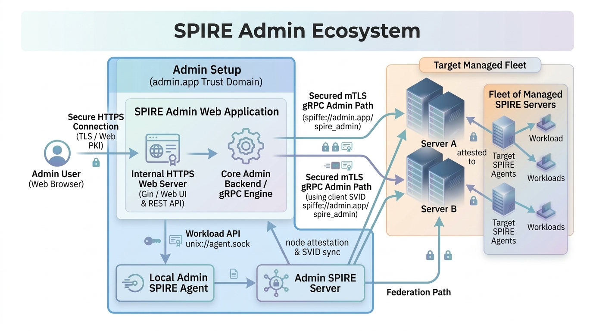
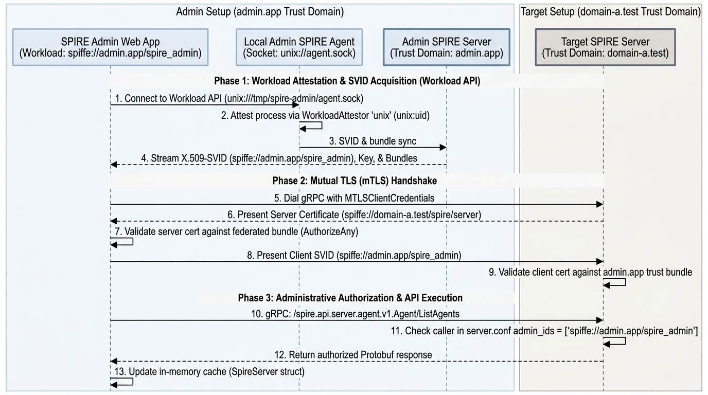
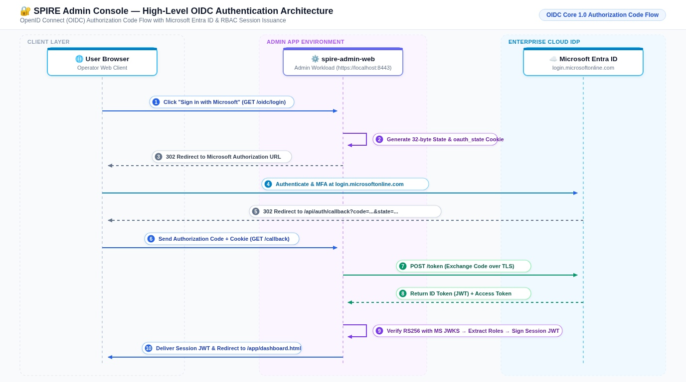

# 🏛️ SPIRE Admin Console - Architecture & Design Document

## 1. System Overview

The **SPIRE Admin Console** is an administrative platform designed to manage and monitor distributed [SPIRE](https://github.com/spiffe/spire) (SPIFFE Runtime Environment) deployments.

The console operates natively as an attested **SPIFFE Workload**. It connects to a local **Admin SPIRE Agent** (which operates under the **Admin SPIRE Server**) via the SPIFFE Workload API over a Unix Domain Socket. Dynamically acquiring and rotating short-lived X.509 SVIDs, the console executes authorized, privileged gRPC administrative operations against target remote SPIRE servers across federated trust domains.

### 1.1 Source Code & File Mapping Matrix

```
spire-admin
├── apps/
│   └── spire-admin-web/
│       ├── main.go                  # Web entry point (CLI flags, env vars, TLS server setup)
│       ├── app.go                   # Gin REST controller, route registration & gRPC bridge
│       └── generate_certs.sh        # OpenSSL script for local HTTPS Web PKI certs
├── auth/
│   ├── auth.go                      # Local auth, JWT session manager, bcrypt, sliding inactivity
│   ├── auth_test.go                 # Unit tests for JWT, passwords, and sessions
│   ├── oidc.go                      # Enterprise OIDC provider, JWKS verification, role mapping
│   └── users.json                   # Local break-glass credential store
├── logger/
│   └── logger.go                    # Leveled diagnostics logger with in-memory ring buffer
├── servers/                         # SPIRE Server coordinator & dedicated category services
│   ├── server.go                    # ServerContext, SpireServer coordinator facade, HCL parser
│   ├── agent.go                     # AgentService (List, Ban, Evict, Purge Expired)
│   ├── bundle.go                    # BundleService (Append, Get, List, Delete federated bundles)
│   ├── entry.go                     # EntryService (CRUD, Workload/Agent/Downstream segmentation)
│   ├── federation.go                # FederationService (List, Create, Refresh, Internal federate)
│   ├── healthcheck.go               # HealthCheckService (gRPC probe, cached status, FetchInfo)
│   ├── localauthority.go            # LocalAuthorityService (Prepare, Activate, Taint, Revoke)
│   ├── upstreamauthority.go         # UpstreamAuthorityService (Taint/Revoke upstream SKID)
│   ├── token.go                     # TokenService (CreateJoinToken)
│   ├── logger.go                    # LoggerService (Remote log level management stubs)
│   ├── validate.go                  # ValidateService (HCL config validation stub)
│   ├── x509.go                      # X509Service (Certificate inspection & parsing stub)
│   ├── utils.go                     # Status formatting & human-readable time helpers
│   ├── categories_test.go           # Unit tests for service initialization and accessors
│   ├── entries_unit_test.go         # Unit tests for registration entry categorization
│   └── integration_test.go          # Multi-domain integration test suite
├── test/
│   └── spire_test_setup.sh          # Multi-domain local SPIRE cluster bootstrapping harness
└── web/                             # Web Frontend Single-Page Application (SPA)
    ├── login.html                   # Authenticated entry point (Local + Entra ID SSO)
    ├── dashboard.html               # Main administrative dashboard UI
    ├── admin.html                   # Standalone User Manager view
    ├── favicon.ico                  # Browser favicon
    ├── css/
    │   └── style.css                # UI layout, responsive grids, themes (Purple, Green, Blue, Gray)
    └── js/
        ├── app.js                   # Client-side auth, inactivity watchdog (30m), theme sync
        ├── main_win.js              # View switcher, navigation, modal managers
        ├── server_win.js            # Server connection cards and health indicators
        ├── agent_win.js             # Agent tables, join token modal, ban/evict handlers
        ├── entries_win.js           # Workload, Agent, and Downstream entry tabs & forms
        ├── bundles_win.js           # Federated bundle viewer & PEM import modal
        ├── federation_win.js        # Dynamic federation & internal peering wizard
        ├── local_authority_win.js   # Local CA lifecycle (Prepare, Activate, Taint/Revoke)
        ├── upstream_authority_win.js# Upstream CA SKID taint/revoke operations
        ├── settings_win.js          # Client-side configuration and theme preferences
        └── log_win.js               # Auto-scrolling server log viewer
```

---

## 2. System Architecture & Topology

### 2.1 Topology & Trust Boundaries

The system architecture spans three distinct execution and network trust domains:

1. **Admin Setup**: Comprises the **SPIRE Admin Web Application (Workload)**, the **Local Admin SPIRE Agent**, and the **Admin SPIRE Server**.
2. 🟪 **User Client Layer**: Administrators interacting with Spire Admin via HTTPS Web Browser. The SPIRE admin web application starts an HTTPS web server.
3. **Target Domains (SPIRE Servers)**: Remote or local SPIRE Servers exposing gRPC endpoints for administrative APIs and HTTPS bundle endpoints for federation.



---

## 3. Security & Identity Architecture

### 3.1 Workload & Control Plane Identity (mTLS & SPIFFE)



The sequence below captures the complete end-to-end identity lifecycle, attestation pipeline, and administrative invocation flow:

- The **SPIRE Admin Web App** runs purely as an attested client workload. It relies on the **Local Admin Agent** (which is registered with and attested by the **Admin SPIRE Server**) to obtain short-lived X.509 SVID credentials via the SPIFFE Workload API.
- Uses **X.509-SVIDs** for control plane mutual authentication (mTLS) when dialing target SPIRE server gRPC endpoints.
- **Trust Verification**: Mutual verification across trust domain boundaries requiring federated bundle exchange.
- **Target Server Authorization**: Target SPIRE servers authorize the console via the HCL attribute `admin_ids = ["spiffe://admin.app/spire_admin"]`.

---

### 3.2 Operator Authentication & Authorization Flow

The console implements **Dual-Mode Authentication**: a local break-glass user store for air-gapped/emergency access, and standard **OpenID Connect (OIDC)** for enterprise Single Sign-On (SSO) with **Microsoft Entra ID (Azure AD)** and Active Directory.

#### High-Level OIDC Authentication Architecture

The SPIRE Admin Console uses standard **OpenID Connect (OIDC)** Authorization Code Flow to authenticate enterprise users and delegate credential management (including Multi-Factor Authentication):



---

## 4. Subsystem Architecture

### 4.1 Dedicated Category Service Architecture (`servers/` package)

The backend SPIRE integration follows a clean **Coordinator Facade** design pattern separating shared connection state from individual SPIRE API service categories.

```
                         ┌───────────────────────────────────┐
                         │      SpireServer (Coordinator)    │
                         │   Embeds *ServerContext           │
                         │   Holds pointers to 11 services   │
                         └─────────────────┬─────────────────┘
                                           │
         ┌─────────────────────────────────┴─────────────────────────────────┐
         │                                                                   │
┌────────▼────────┐                                                 ┌────────▼────────┐
│  ServerContext  │                                                 │ Category Services│
│ - sync.RWMutex  │                                                 │ • AgentService  │
│ - gRPC conn     │◄────────────────── Shares Context ──────────────┤ • BundleService │
│ - X509Source    │                                                 │ • EntryService  │
│ - Cached Caches │                                                 │ • FederationSvc │
│ - Connect/Close │                                                 │ • HealthCheckSvc│
└─────────────────┘                                                 │ • LocalAuthSvc  │
                                                                    │ • UpstreamAuth  │
                                                                    │ • TokenService  │
                                                                    │ • LoggerService │
                                                                    │ • ValidateSvc   │
                                                                    │ • X509Service   │
                                                                    └─────────────────┘
```

#### 1. Shared State: `ServerContext` (`servers/server.go`)

`ServerContext` encapsulates all thread-safe networking handles, caches, and connection lifecycles for a single SPIRE server endpoint:

```go
type ServerContext struct {
}
```

- **Connection Management (`Connect`)**: Thread-safe check on `s.conn`. Establishes SPIFFE Workload API mTLS via `workloadapi.NewX509Source` over the agent Unix domain socket or insecure transport for development.
- **Graceful Teardown (`Close`)**: Cancels background contexts, terminates active gRPC channels, and closes X.509 SVID sources.

---

#### 2. Dedicated Category Services

Each SPIRE functional area is encapsulated in its own dedicated structure accepting `*ServerContext`:

1. AgentService
2. BundleService
3. EntryService
4. FederationService
5. HealthCheckService
6. LocalAuthorityService
7. UpstreamAuthorityService
8. TokenService
9. LoggerService
10. ValidateService
11. X509Service
---

#### 3. Coordinator Facade: `SpireServer` (`servers/server.go`)

`SpireServer` coordinates the category services, provides typed accessors, and maintains backward compatibility:

```go
type SpireServer struct {
    *ServerContext

    agent             *AgentService
    bundle            *BundleService
    entry             *EntryService
    federation        *FederationService
    healthcheck       *HealthCheckService
    localauthority    *LocalAuthorityService
    logger            *LoggerService
    token             *TokenService
    upstreamauthority *UpstreamAuthorityService
    validate          *ValidateService
    x509              *X509Service
}
```

- **Category Accessors**: `s.Agent()`, `s.Bundle()`, `s.Entry()`, `s.Federation()`, `s.HealthCheck()`, `s.LocalAuthority()`, `s.UpstreamAuthority()`, `s.Token()`, `s.Logger()`, `s.Validate()`, `s.X509()`.
- **Delegation Methods**: Compatibility methods like `s.ListAgents(...)` directly delegate to `s.Agent().ListAgents(...)`, allowing callers to transition seamlessly without breakage.

---

### 4.2 Backend Service Implementation & SPIRE SDK v1 Mappings

The table below maps internal Go service methods in [`servers/`](file:///home/gangaram/playground/spire-admin/servers) to their underlying SPIRE API SDK Protobuf gRPC contracts:

| Feature Domain         | Go Method                                                                                                                                                                                                                          | Target SPIRE SDK Interface & Method                                                                | Protobuf Request / Response Types                                     |
|:---------------------- |:---------------------------------------------------------------------------------------------------------------------------------------------------------------------------------------------------------------------------------- |:-------------------------------------------------------------------------------------------------- |:--------------------------------------------------------------------- |
| **Health Check**       | [`CheckHealth()`](file:///home/gangaram/playground/spire-admin/servers/healthcheck.go#L26)                                                                                                                                         | `grpc_health_v1.HealthClient.Check`                                                                | `HealthCheckRequest` &rarr; `HealthCheckResponse`                     |
| **Agent Listing**      | [`ListAgents()`](file:///home/gangaram/playground/spire-admin/servers/agent.go#L55)                                                                                                                                                | `agentv1.AgentClient.ListAgents`                                                                   | `ListAgentsRequest` &rarr; `ListAgentsResponse` (paginated)           |
| **Agent Info**         | [`GetAgentInfo()`](file:///home/gangaram/playground/spire-admin/servers/agent.go#L170)                                                                                                                                             | `agentv1.AgentClient.GetAgent`                                                                     | `GetAgentRequest{Id}` &rarr; `types.Agent`                            |
| **Agent Token**        | [`CreateJoinToken()`](file:///home/gangaram/playground/spire-admin/servers/token.go#L22)                                                                                                                                           | `agentv1.AgentClient.CreateJoinToken`                                                              | `CreateJoinTokenRequest{Ttl}` &rarr; `types.JoinToken`                |
| **Agent Ban**          | [`BanAgent()`](file:///home/gangaram/playground/spire-admin/servers/agent.go#L128)                                                                                                                                                 | `agentv1.AgentClient.BanAgent`                                                                     | `BanAgentRequest{Id}` &rarr; `Empty`                                  |
| **Agent Evict**        | [`EvictAgent()`](file:///home/gangaram/playground/spire-admin/servers/agent.go#L149)                                                                                                                                               | `agentv1.AgentClient.DeleteAgent`                                                                  | `DeleteAgentRequest{Id}` &rarr; `Empty`                               |
| **Purge Expired**      | [`PurgeExpiredAgents()`](file:///home/gangaram/playground/spire-admin/servers/agent.go#L203)                                                                                                                                       | `agentv1.AgentClient.ListAgents` + `DeleteAgent`                                                   | Filter `ByCanReattest=true`, evaluate `X509SvidExpiresAt`             |
| **Entry Listing**      | [`ListEntries()`](file:///home/gangaram/playground/spire-admin/servers/entry.go#L33)                                                                                                                                               | `entryv1.EntryClient.ListEntries`                                                                  | `ListEntriesRequest` &rarr; `ListEntriesResponse` (paginated)         |
| **Entry Create**       | [`CreateEntry()`](file:///home/gangaram/playground/spire-admin/servers/entry.go#L120)                                                                                                                                              | `entryv1.EntryClient.BatchCreateEntry`                                                             | `BatchCreateEntryRequest{Entries}` &rarr; `BatchCreateEntryResponse`  |
| **Entry Update**       | [`UpdateEntry()`](file:///home/gangaram/playground/spire-admin/servers/entry.go#L186)                                                                                                                                              | `entryv1.EntryClient.BatchUpdateEntry`                                                             | `BatchUpdateEntryRequest{Entries}` &rarr; `BatchUpdateEntryResponse`  |
| **Entry Delete**       | [`DeleteEntry()`](file:///home/gangaram/playground/spire-admin/servers/entry.go#L148)                                                                                                                                              | `entryv1.EntryClient.BatchDeleteEntry`                                                             | `BatchDeleteEntryRequest{Ids}` &rarr; `BatchDeleteEntryResponse`      |
| **Bundle Get**         | [`GetBundle()`](file:///home/gangaram/playground/spire-admin/servers/bundle.go#L53)                                                                                                                                                | `bundlev1.BundleClient.GetBundle` / `GetFederatedBundle`                                           | `GetBundleRequest` / `GetFederatedBundleRequest{TrustDomain}`         |
| **Bundle Set**         | [`SetFederatedBundle()`](file:///home/gangaram/playground/spire-admin/servers/bundle.go#L152)                                                                                                                                      | `bundlev1.BundleClient.BatchSetFederatedBundle`                                                    | `BatchSetFederatedBundleRequest{Bundle}`                              |
| **Bundle Delete**      | [`DeleteFederatedBundle()`](file:///home/gangaram/playground/spire-admin/servers/bundle.go#L86)                                                                                                                                    | `bundlev1.BundleClient.BatchDeleteFederatedBundle`                                                 | `BatchDeleteFederatedBundleRequest{TrustDomains, Mode}`               |
| **Federations**        | [`ListFederationRelationships()`](file:///home/gangaram/playground/spire-admin/servers/federation.go#L112)                                                                                                                         | `trustdomainv1.TrustDomainClient.ListFederationRelationships`                                      | `ListFederationRelationshipsRequest` (paginated)                      |
| **Federation Mutate**  | [`CreateFederationRelationship()`](file:///home/gangaram/playground/spire-admin/servers/federation.go#L61)                                                                                                                         | `trustdomainv1.TrustDomainClient.BatchCreateFederationRelationship`                                | `BatchCreateFederationRelationshipRequest{...}`                       |
| **Federation Refresh** | [`RefreshFederationBundle()`](file:///home/gangaram/playground/spire-admin/servers/federation.go#L140)                                                                                                                             | `trustdomainv1.TrustDomainClient.RefreshBundle`                                                    | `RefreshBundleRequest{TrustDomain}` &rarr; `Empty`                    |
| **Local Key State**    | [`ShowLocalX509Authorities()`](file:///home/gangaram/playground/spire-admin/servers/localauthority.go#L24)                                                                                                                         | `localauthorityv1.LocalAuthorityClient.GetX509AuthorityState`                                      | `GetX509AuthorityStateRequest` &rarr; `GetX509AuthorityStateResponse` |
| **Local Rotate**       | [`PrepareLocalX509Authority()`](file:///home/gangaram/playground/spire-admin/servers/localauthority.go#L42)                                                                                                                        | `localauthorityv1.LocalAuthorityClient.PrepareX509Authority`                                       | `PrepareX509AuthorityRequest` &rarr; `PrepareX509AuthorityResponse`   |
| **Local Activate**     | [`ActivateLocalX509Authority()`](file:///home/gangaram/playground/spire-admin/servers/localauthority.go#L62)                                                                                                                       | `localauthorityv1.LocalAuthorityClient.ActivateX509Authority`                                      | `ActivateX509AuthorityRequest{AuthorityId}`                           |
| **Local Taint/Revoke** | [`TaintLocalX509Authority()`](file:///home/gangaram/playground/spire-admin/servers/localauthority.go#L96) / [`RevokeLocalX509Authority()`](file:///home/gangaram/playground/spire-admin/servers/localauthority.go#L79)             | `localauthorityv1.LocalAuthorityClient.TaintX509Authority` / `RevokeX509Authority`                 | `TaintX509AuthorityRequest` / `RevokeX509AuthorityRequest`            |
| **Upstream CA Ops**    | [`TaintUpstreamX509Authority()`](file:///home/gangaram/playground/spire-admin/servers/upstreamauthority.go#L60) / [`RevokeUpstreamX509Authority()`](file:///home/gangaram/playground/spire-admin/servers/upstreamauthority.go#L41) | `localauthorityv1.LocalAuthorityClient.TaintX509UpstreamAuthority` / `RevokeX509UpstreamAuthority` | `TaintX509UpstreamAuthorityRequest{SubjectKeyId}`                     |

---

### 4.3 REST API Endpoints Specification (`apps/spire-admin-web/app.go`)

The web console exposes a comprehensive RESTful gateway over TLS. All endpoints beneath `/api/` (except `/api/login` and `/api/auth/*`) require a valid Bearer JWT header verified via [`auth.Manager.AuthMiddleware()`](file:///home/gangaram/playground/spire-admin/auth/auth.go#L211).

```
POST   /api/login                                 # Authenticate user credentials & issue JWT
GET    /api/logs                                  # Retrieve memory-buffered application logs
GET    /api/servers                               # List all configured server profiles & statuses
POST   /api/servers                               # Add new server profile and connect
DELETE /api/servers/:id                           # Remove server profile and disconnect gRPC
POST   /api/servers/:id/refresh                   # Trigger asynchronous FetchInfo & cache refresh

# Agent Subsystem
GET    /api/servers/:id/agents                    # List connected agents
GET    /api/servers/:id/agents/info?spiffe_id=... # Get detailed properties for single agent
POST   /api/servers/:id/agents/evict              # Evict agent by SPIFFE ID
POST   /api/servers/:id/agents/ban                # Ban agent by SPIFFE ID
POST   /api/servers/:id/agents/purge-expired      # Purge all expired agents in bulk

# Registration Entries Subsystem
GET    /api/servers/:id/entries                   # List all registration entries
GET    /api/servers/:id/entries/workloads         # Segmented workload entries
GET    /api/servers/:id/entries/agents            # Segmented agent entries
GET    /api/servers/:id/entries/downstreams       # Segmented downstream server entries
GET    /api/servers/:id/entries/:entry_id/info    # Get entry details
POST   /api/servers/:id/entries                   # Create registration entry
PUT    /api/servers/:id/entries/:entry_id         # Update entry properties (TTL, DNS, Flags)
DELETE /api/servers/:id/entries/:entry_id         # Delete entry

# Federated Trust Bundles Subsystem
GET    /api/servers/:id/bundles                   # List federated bundles
GET    /api/servers/:id/bundles/info?trust_domain # Get bundle details (X.509/JWT authorities)
POST   /api/servers/:id/bundles                   # Set/Import bundle from PEM content
DELETE /api/servers/:id/bundles?trust_domain      # Delete federated bundle (Mode: RESTRICT)

# Dynamic Federation Subsystem
GET    /api/servers/:id/federations               # List federation relationships
GET    /api/servers/:id/federations/info?trust_...# Get relationship details
POST   /api/servers/:id/federations               # Create federation relationship
PUT    /api/servers/:id/federations               # Update federation relationship
POST   /api/servers/:id/federations/refresh       # Trigger immediate bundle sync
DELETE /api/servers/:id/federations               # Terminate federation relationship
POST   /api/servers/:id/federations/internal      # Automated bilateral internal server federation

# Signing Authorities Subsystem
GET    /api/servers/:id/local-authority           # Query Active, Prepared, Old local authorities
POST   /api/servers/:id/local-authority/rotate    # Prepare new authority key pair
POST   /api/servers/:id/local-authority/activate  # Activate prepared authority
POST   /api/servers/:id/local-authority/delete    # Taint and revoke old authority
POST   /api/servers/:id/upstream-authority/taint  # Taint upstream authority by SKID
POST   /api/servers/:id/upstream-authority/revoke # Revoke upstream authority by SKID

# Authentication & Identity Provider Discovery
GET    /api/auth/providers                        # Query available authentication mechanisms (OIDC, Local)
GET    /api/auth/oidc/login                       # Initiate OIDC authorization code flow with Microsoft Entra ID
GET    /api/auth/callback                         # OIDC authorization code exchange & JWT session issuance
POST   /api/login                                 # Authenticate local break-glass user & acquire JWT session
POST   /api/change-password                       # Update caller's password
POST   /api/logout                                # Invalidate active session token
POST   /api/users                                 # Provision user (Admin role required)
```

---

### 4.4 Security, Authentication & Session Architecture

Implemented in [`auth/auth.go`](file:///home/gangaram/playground/spire-admin/auth/auth.go) and [`auth/oidc.go`](file:///home/gangaram/playground/spire-admin/auth/oidc.go):

- **Dual-Mode Identity Model**:
  - **Local Break-Glass**: Restricted JSON file ([`users.json`](file:///home/gangaram/playground/spire-admin/users.json), permissions `0600`) evaluated via `golang.org/x/crypto/bcrypt`. Defaults to `admin` / `admin123` if missing, overridable via `ADMIN_USERNAME` and `ADMIN_PASSWORD`.
  - **Enterprise OIDC Federation**: Discovers Microsoft Entra ID / ADFS endpoints, verifies RS256 token signatures against Microsoft's public JWKS, and extracts directory roles (`roles`) or security groups (`groups`) to resolve `is_admin`.
- **Session Management**: Both authentication paths converge on `auth.Manager` to issue internal HS256 JWT tokens with a sliding inactivity window tracked via `lastActivity sync.Map` (default timeout: 30 minutes).
- **CSRF Defense**: OIDC authorization code flow uses cryptographically random 32-byte `state` tokens set in HTTP-only temporary cookies.

---

## 5. Supported Operations & Capabilities Mapping

The following table shows which standard `spire-server` features are supported by the **SPIRE Admin Console**:

| SPIRE Server Category   | Supported in Console | Platform Capabilities                                                                              | Relevance / Notes                                                                      |
|:----------------------- |:--------------------:|:-------------------------------------------------------------------------------------------------- |:-------------------------------------------------------------------------------------- |
| **`agent`**             | ✅                    | View connected agents, inspect agent details, ban or delete agents, and clean up expired agents.   | Managed via `AgentService`. Needed to monitor and manage all active SPIRE agents.      |
| **`bundle`**            | ✅                    | View, upload, and delete root CA certificates (trust bundles) for local and federated domains.     | Managed via `BundleService`. Needed for cross-domain trust exchange.                   |
| **`entry`**             | ✅                    | Create, view, edit, and delete registration entries for workloads, agents, and downstream servers. | Managed via `EntryService`. Core feature used to assign identities (SPIFFE IDs).       |
| **`federation`**        | ✅                    | Add, update, refresh, and remove federation links between different trust domains.                 | Managed via `FederationService`. Enables cross-domain workload communication.          |
| **`healthcheck`**       | ✅                    | Check if remote SPIRE servers are online, connecting, or offline in real time.                     | Managed via `HealthCheckService`. Live status badges on the dashboard.                 |
| **`jwt`**               | ❌                    | Not available in the console.                                                                      | Used for testing JWT tokens on the command line; not needed in the admin UI.           |
| **`localauthority`**    | ✅                    | Create new local signing keys, switch to them, and disable old or compromised keys.                | Managed via `LocalAuthorityService`. Rotates server certificate keys without downtime. |
| **`logger`**            | ❌                    | Backend stub exists (`LoggerService`). Not exposed in the UI.                                      | Used to change server log levels locally on the host; console has its own log viewer.  |
| **`run`**               | ❌                    | Not available in the console.                                                                      | Used to start the SPIRE server process. Not relevant for admin application.            |
| **`token`**             | ❌                    | Managed via `TokenService`. Backend code exists, but no button or API is exposed in the UI.        | Creates a one-time use join token.                                                     |
| **`upstreamauthority`** | ✅                    | Disable or remove trust for upstream parent CA keys using their Key ID (SKID).                     | Managed via `UpstreamAuthorityService`. Manages upstream CA keys.                      |
| **`validate`**          | ❌                    | Backend stub exists (`ValidateService`). Not exposed in the UI.                                    | Checks local configuration files before starting the server.                           |
| **`x509`**              | ❌                    | Backend stub exists (`X509Service`). Not exposed in the UI.                                        | Used for manually testing certificates.                                                |

---

## 6. Security Best Practices

1. **Workload API Socket Permissions**: The SPIRE agent socket (`agent.sock`) must be protected with Unix file permissions (`0600` or `0660`) allowing access only to authorized local processes.
2. **Short Token TTLs**: Join tokens generated for agent attestation should use minimum necessary TTLs.
3. **Audit Logging**: All administrative actions (evictions, bans, entry deletions, key rotation) are logged through the internal structured logger (`logger/`).
4. **Credential Isolation**: The web server never stores or logs plain text passwords; credentials are encrypted and hashed using `bcrypt`.

---

## 7. Roadmap & TODOs

The following features and hardening initiatives:

- **High-Quality Secure Web Interface**:
  - Modernize and refine the web UI/UX and reinforce web security headers.
- **Application State Persistence & Recovery**:
  - Persist configured server profiles, active connections, and session states across application restarts so the console seamlessly recovers its previous working state. *(HCL profile saving is implemented in the backend, but it should be automated).*
- **Enterprise User Login & Identity Management**:
  - [x] **Active Directory / Microsoft Entra ID (OIDC) Single Sign-On (SSO)**: Implemented in `auth/oidc.go` supporting OIDC Authorization Code Flow, JWKS verification, and `roles`/`groups` claim mapping to `is_admin`.
  - [ ] **Public Key Authentication** / WebAuthn FIDO2 direct support.
- **Backend Architecture & Code Refactoring**:
  - [x] **Dedicated Category Service Architecture**: Refactored central SPIRE server logic into dedicated structures for each category (`AgentService`, `BundleService`, `EntryService`, `FederationService`, `HealthCheckService`, `LocalAuthorityService`, `UpstreamAuthorityService`, `TokenService`, `LoggerService`, `ValidateService`, `X509Service`) unified under the `ServerContext` and coordinated via the `SpireServer` facade.
- **Code Audit & Threat Modeling**:
  - Perform comprehensive code auditing and formal Zero-Trust threat modeling covering trust domain boundaries, mTLS transport channels, socket permissions, and gRPC authorization flows.
- **Interactive SPIRE Config Builder?**:
  - Implement a guided configuration generator for `spire-server` and `spire-agent` to eliminate tedious manual HCL writing for plugin blocks (datastores, node/workload attestors, key managers) and multi-domain federation endpoints.
