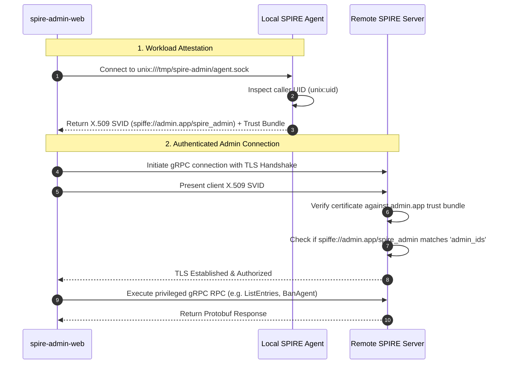
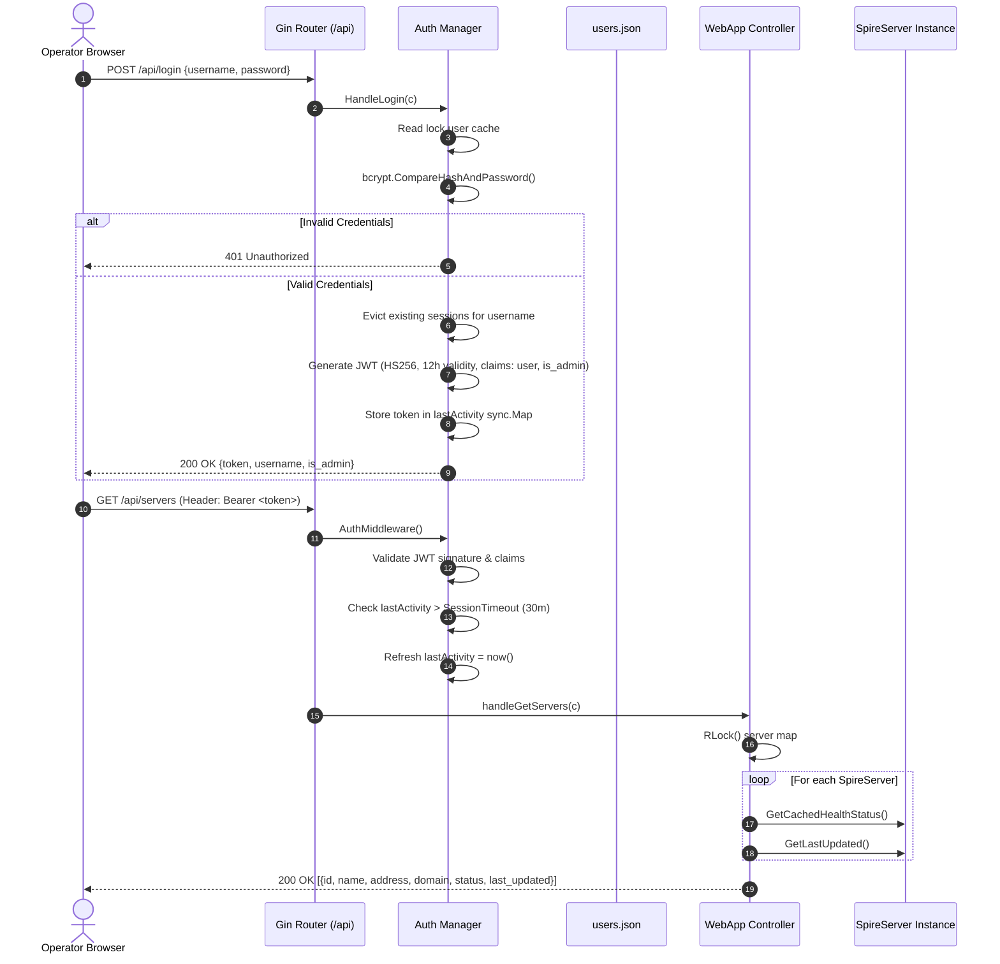
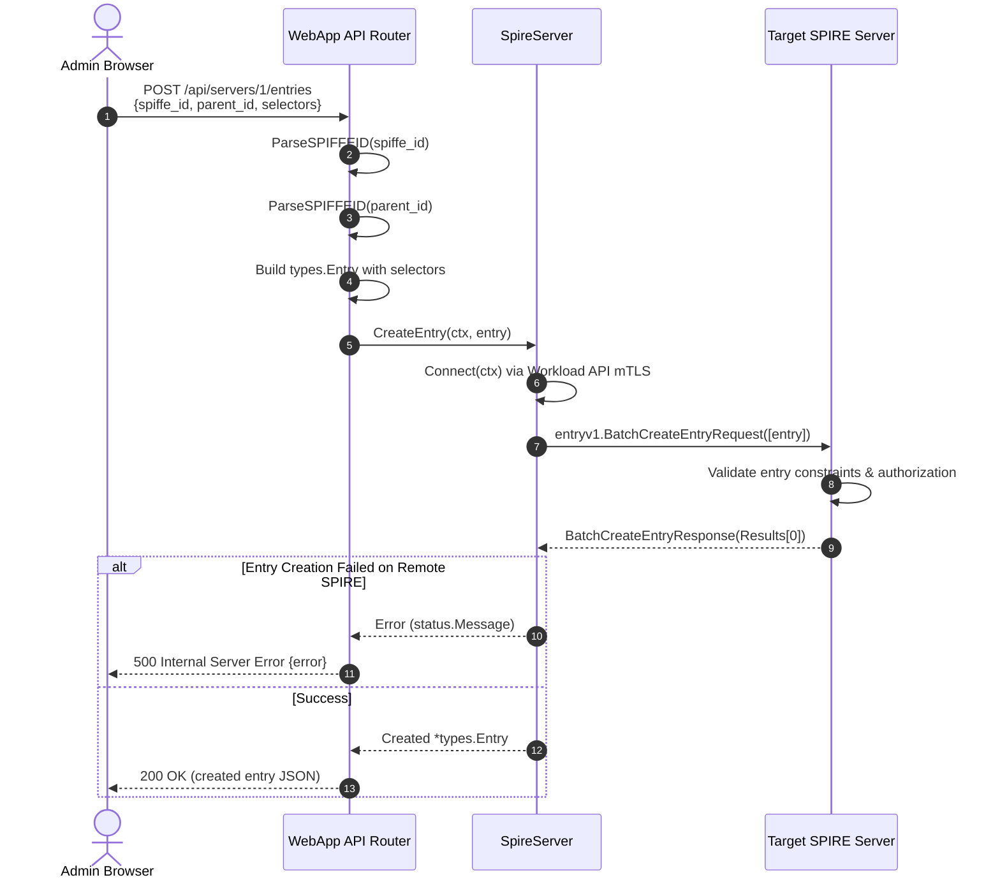
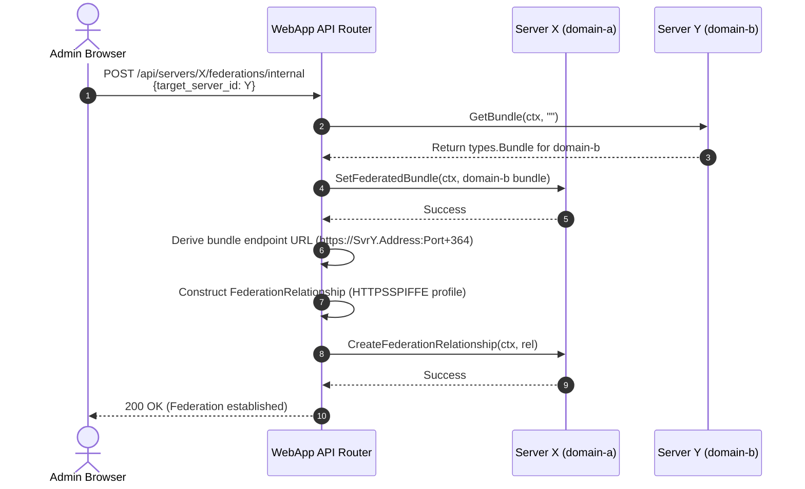
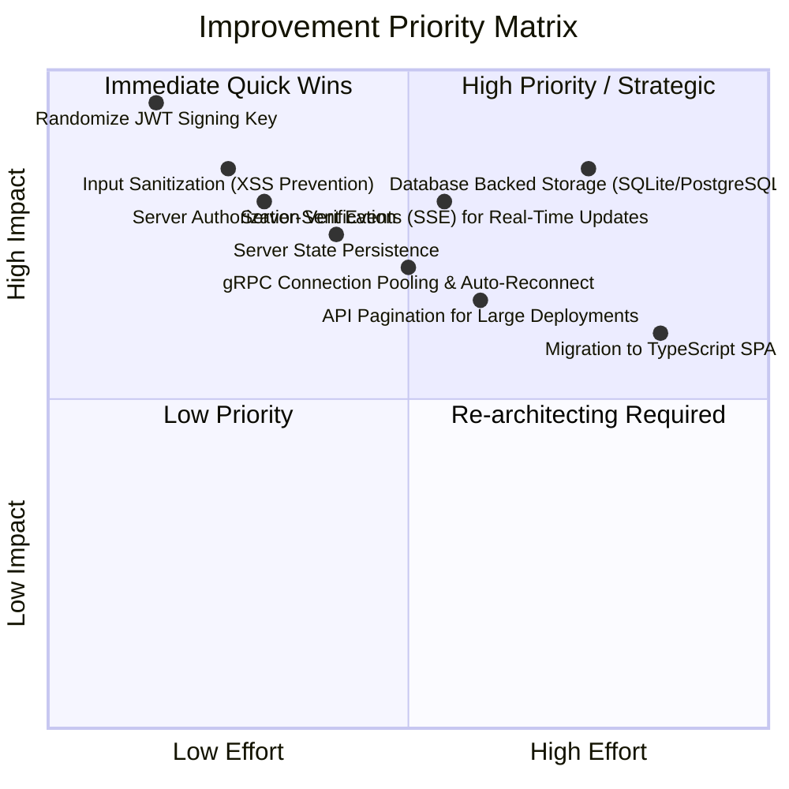

# 🏛️ SPIRE Admin Web Application - Architecture & Technical Design Document

**Document Version:** 1.0.0  
**Author:** Principal Software Architect  
**Status:** Approved / Active Architecture Specification  
**Target System:** `spire-admin-web`  

---

## Table of Contents
1. [Executive Summary](#1-executive-summary)
2. [High-Level Design (HLD)](#2-high-level-design-hld)
   - 2.1 [System Context & Goals](#21-system-context--goals)
   - 2.2 [Zero-Trust Security & Identity Architecture](#22-zero-trust-security--identity-architecture)
   - 2.3 [High-Level Architectural Topology](#23-high-level-architectural-topology)
   - 2.4 [End-to-End Sequence Diagrams](#24-end-to-end-sequence-diagrams)
3. [Low-Level Design (LLD) by Component](#3-low-level-design-lld-by-component)
   - 3.1 [Application Host & HTTP Router (`apps/spire-admin-web`)](#31-application-host--http-router-appsspire-admin-web)
   - 3.2 [Authentication & RBAC Subsystem (`auth`)](#32-authentication--rbac-subsystem-auth)
   - 3.3 [Core SPIRE Server Manager (`servers.SpireServer`)](#33-core-spire-server-manager-serversspireserver)
   - 3.4 [Agent Management Subsystem (`servers/agent.go`)](#34-agent-management-subsystem-serversagentgo)
   - 3.5 [Registration Entries Subsystem (`servers/entries.go`)](#35-registration-entries-subsystem-serversentriesgo)
   - 3.6 [Trust Bundles Subsystem (`servers/bundles.go`)](#36-trust-bundles-subsystem-serversbundlesgo)
   - 3.7 [Dynamic Federation Subsystem (`servers/federations.go`)](#37-dynamic-federation-subsystem-serversfederationsgo)
   - 3.8 [Signing Authorities Subsystem (`servers/signing_authorities.go`)](#38-signing-authorities-subsystem-serverssigning_authoritiesgo)
   - 3.9 [Frontend Web Client (`web/`, `web/js/`, `web/css/`)](#39-frontend-web-client-web-webjs-webcss)
4. [Design Choices & Technology Evaluation](#4-design-choices--technology-evaluation)
   - 4.1 [Backend Languages, Frameworks & Modules](#41-backend-languages-frameworks--modules)
   - 4.2 [Frontend Architecture & UI Choices](#42-frontend-architecture--ui-choices)
   - 4.3 [Key Architectural Trade-offs](#43-key-architectural-trade-offs)
5. [Identified Technical Debt & Recommendations for Improvement](#5-identified-technical-debt--recommendations-for-improvement)
   - 5.1 [Security Hardening (Critical)](#51-security-hardening-critical)
   - 5.2 [State Persistence & Reliability](#52-state-persistence--reliability)
   - 5.3 [Observability & Real-Time Communication](#53-observability--real-time-communication)
   - 5.4 [Performance & Scalability](#54-performance--scalability)
   - 5.5 [Frontend Architecture Modernization](#55-frontend-architecture-modernization)
   - 5.6 [Testing Strategy & CI/CD](#56-testing-strategy--cicd)

---

## 1. Executive Summary

The **SPIRE Admin Web Application** (`spire-admin-web`) is a centralized, zero-trust control plane designed to inspect, monitor, and administrate distributed [SPIRE](https://spiffe.io/) (SPIFFE Runtime Environment) deployments. 

Unlike conventional web consoles that rely on static database credentials, API tokens, or hardcoded administrative passwords, `spire-admin-web` is architected as a **native SPIFFE Workload**. It leverages the SPIFFE Workload API to dynamically obtain short-lived cryptographic X.509 SVIDs (SPIFFE Verifiable Identity Documents) from a local SPIRE Agent over a Unix Domain Socket. These SVIDs are then presented over Mutual TLS (mTLS) to remote SPIRE Servers to perform authorized gRPC administrative operations.

---

## 2. High-Level Design (HLD)

### 2.1 System Context & Goals

```mermaid
graph TB
    subgraph Client Tier
        Browser["Operator Browser (HTTPS/WSS)"]
    end

    subgraph Host Boundary ["spire-admin-web Host"]
        WebServer["Gin HTTP / Reverse Proxy (:8443)"]
        AuthMgr["Auth & RBAC Manager (JWT + bcrypt)"]
        ServerMgr["SPIRE Server Manager (In-Memory Pool)"]
        X509Src["SPIFFE X.509 Source (Workload API Client)"]
        LocalAgent[("Local SPIRE Agent (/tmp/spire-admin/agent.sock)")]
    end

    subgraph Remote SPIFFE Trust Domains
        SpireSvr1["SPIRE Server A (domain-a.test:8082)"]
        SpireSvr2["SPIRE Server B (domain-b.test:8083)"]
        PeerSvr["Federated Partner (external.org)"]
    end

    Browser -->|HTTPS / REST / JSON| WebServer
    WebServer --> AuthMgr
    WebServer --> ServerMgr
    ServerMgr -->|Request SVID & Bundle| X509Src
    X509Src <-->|Workload API (Unix Socket)| LocalAgent
    ServerMgr -->|gRPC over mTLS (SPIFFE Identity)| SpireSvr1
    ServerMgr -->|gRPC over mTLS (SPIFFE Identity)| SpireSvr2
    SpireSvr1 <-->|Bundle Endpoint / HTTPS| PeerSvr
```

#### Core Capabilities
1. **Multi-Server Control Plane**: Register and manage multiple remote SPIRE servers across distinct trust domains from a single unified pane.
2. **Workload Identity Lifecycle**: Full CRUD lifecycle operations over registration entries (Workloads, Agents, Downstream nodes).
3. **Agent Management**: Monitor attestation status, serial numbers, re-attestation eligibility; generate single-use Join Tokens; evict/ban rogue agents; batch-purge expired nodes.
4. **Trust Domain Federation**: Dynamically configure federation relationships, exchange trust bundles, and trigger instantaneous bundle refreshes.
5. **Certificate Authority (CA) Operations**: Local X.509 authority rotation (Prepare, Activate), taint/revoke compromised local CAs, and taint/revoke upstream CAs by Subject Key Identifier (SKID).
6. **Role-Based Access Control**: Separate administrative privileges (account creation, server mutation) from operational read/write actions.

---

### 2.2 Zero-Trust Security & Identity Architecture

The defining architectural attribute of `spire-admin-web` is its **elimination of static secrets**:



1. **Attestation & Identity Acquisition**: On startup, `servers.SpireServer` connects to the local SPIRE agent socket specified by `-socket`. The agent attests the process using kernel metadata (`unix:uid`). Upon verification, the agent issues an X.509 SVID with SPIFFE ID `spiffe://admin.app/spire_admin`.
2. **Automatic Key Rotation**: The `go-spiffe/v2/workloadapi.X509Source` automatically streams renewed certificates prior to expiration, enabling zero-downtime key rotation without restarting the web service.
3. **Remote Server Verification**: The remote SPIRE server's configuration specifies:
   ```hcl
   server {
       trust_domain = "domain-a.test"
       admin_ids = ["spiffe://admin.app/spire_admin"]
   }
   ```
   gRPC interceptors on the remote SPIRE server inspect the peer certificate's SAN URI. If it matches `admin_ids`, the request is granted access to the SPIRE Server APIs.

---

### 2.3 High-Level Architectural Topology

The software is structured into four primary layers:

```
┌────────────────────────────────────────────────────────────────────────┐
│                        PRESENTATION TIER (SPA)                         │
│  - Vanilla ES6 Modules (app.js, main_win.js, entries_win.js, etc.)     │
│  - CSS3 Modern Design System (style.css, Theme Custom Properties)       │
│  - Static Asset Hosting (/app/login.html, /app/dashboard.html)         │
└───────────────────────────────────┬────────────────────────────────────┘
                                    │ HTTPS (TLS 1.3 / JSON REST)
┌───────────────────────────────────▼────────────────────────────────────┐
│                    APPLICATION & SECURITY LAYER                        │
│  - Gin Web Router (engine, recovery, CORS, static file server)         │
│  - Auth Engine: JWT HMAC-SHA256, bcrypt password hashing               │
│  - Session Inactivity Watchdog (Sliding 30-min window via sync.Map)    │
│  - Leveled Diagnostics Logger & In-Memory Ring Buffer (50KB cap)       │
└───────────────────────────────────┬────────────────────────────────────┘
                                    │ Internal Go Method Calls
┌───────────────────────────────────▼────────────────────────────────────┐
│                   SPIRE INTEGRATION & DOMAIN LOGIC                     │
│  - servers.SpireServer Controller (State Cache, Health Probe, Locks)   │
│  - SPIFFE Workload API Client (go-spiffe/v2 X509Source mTLS Dial)      │
│  - HCL Configuration Persistence Engine (hashicorp/hcl/v2)             │
│  - Specialized Service Clients:                                        │
│    • agentv1.AgentClient       • entryv1.EntryClient                   │
│    • bundlev1.BundleClient     • trustdomainv1.TrustDomainClient       │
│    • localauthorityv1.LocalAuthorityClient                             │
└───────────────────────────────────┬────────────────────────────────────┘
                                    │ gRPC over SPIFFE mTLS (TCP)
┌───────────────────────────────────▼────────────────────────────────────┐
│                 DISTRIBUTED SPIRE CONTROL PLANE                        │
│  - Remote SPIRE Server Instances (domain-a, domain-b, admin.app)       │
│  - Upstream / Downstream SPIRE Server Topologies                       │
│  - Dynamic Federated Partners                                          │
└────────────────────────────────────────────────────────────────────────┘
```

---

### 2.4 End-to-End Sequence Diagrams

#### Sequence 1: User Login, Session Creation & Server List Fetch



---

#### Sequence 2: Server Registration Entry Creation



---

#### Sequence 3: Dynamic Cross-Server Federation Setup



---

## 3. Low-Level Design (LLD) by Component

### 3.1 Application Host & HTTP Router (`apps/spire-admin-web`)

#### File: `apps/spire-admin-web/main.go`
- **Responsibilities**:
  - Command-line argument parsing (`-socket`, `-cert`, `-key`, `-port`, `-log-level`, `-session-timeout`).
  - Pre-flight filesystem sanity validation (verifies existence of Unix agent socket, TLS certificate, and private key).
  - Initializes logging subsystem level.
  - Hands over execution to `run()`.

#### File: `apps/spire-admin-web/app.go`
- **Data Structures**:
  ```go
  type WebApp struct {
      mu           sync.RWMutex
      servers      map[int]*servers.SpireServer
      Auth         *auth.Manager
      nextServerID int
      socket       string
  }
  
  type webLogWriter struct{}
  ```
- **Concurrency & State Management**:
  - `servers` map is protected by `sync.RWMutex`.
  - Read-heavy endpoints (`handleGetServers`, `handleGetAgents`, `handleGetEntries`) acquire `RLock()`.
  - Server mutation endpoints (`handleAddServer`, `handleDeleteServer`) acquire write `Lock()`.
  - Log streaming: `webLogWriter` implements `io.Writer`, capturing the last 50,000 bytes into `webLogBuffer` protected by `webLogMu sync.Mutex`.
- **Router Configuration**:
  - Uses `gin.Default()`.
  - Explicitly invokes `r.SetTrustedProxies(nil)` to avoid proxy spoofing warnings.
  - Serves static assets from `./web` mapped to `/app` route and root redirect to `/app/login.html`.
  - HTTPS TLS server initiated via `r.RunTLS(":"+portStr, certFile, keyFile)`.

---

### 3.2 Authentication & RBAC Subsystem (`auth`)

#### File: `auth/auth.go`
- **Data Structures**:
  ```go
  type User struct {
      Username string `json:"username"`
      Password string `json:"password"` // bcrypt hash
      IsAdmin  bool   `json:"is_admin"`
  }

  type Claims struct {
      Username string `json:"username"`
      IsAdmin  bool   `json:"is_admin"`
      jwt.RegisteredClaims
  }

  type Manager struct {
      mu             sync.RWMutex
      users          map[string]*User
      jwtSigningKey  []byte
      SessionTimeout time.Duration
      lastActivity   sync.Map // string (token) -> time.Time
  }
  ```
- **Key Algorithms & Flows**:
  - **Password Hashing**: Uses `golang.org/x/crypto/bcrypt` with `bcrypt.DefaultCost` (10 rounds). Plaintext passwords are never stored in memory or serialized.
  - **Token Generation**: Signs JWTs using `jwt.SigningMethodHS256`. Claims include standard `RegisteredClaims` (12-hour maximum lifetime, issued at, unique timestamp ID) plus custom identity and authorization fields (`Username`, `IsAdmin`).
  - **Sliding Inactivity Expiration**:
    1. During `AuthMiddleware()`, the JWT signature is verified.
    2. The token string is looked up in `lastActivity sync.Map`.
    3. If `time.Since(lastSeen) > SessionTimeout`, the token is evicted and returns `401 Unauthorized` (`"Session expired due to inactivity"`).
    4. Otherwise, `lastActivity.Store(tokenStr, time.Now())` refreshes the sliding window.
  - **RBAC Enforcement**:
    - `AuthMiddleware()` populates Gin context with `"username"` and `"is_admin"`.
    - `AdminMiddleware()` asserts `isAdmin == true`, returning `403 Forbidden` if the user is an operator.
  - **Persistence**: Serializes user dictionary to `users.json` with file permissions `0600`. Defaults to environment variables `ADMIN_USERNAME` / `ADMIN_PASSWORD` (or `admin`/`admin123`) on initial run if `users.json` is missing.

---

### 3.3 Core SPIRE Server Manager (`servers.SpireServer`)

#### File: `servers/server.go`
- **Data Structures**:
  ```go
  type SpireServer struct {
      mu               sync.RWMutex
      Nickname         string
      Address          string
      Port             string
      Domain           string
      AgentSocket      string
      HealthStatus     ServerHealthStatus // Connecting (0), Online (1), Offline (2)
      LastUpdated      time.Time
      ctx              context.Context
      cancel           context.CancelFunc
      OnHealthChange   func(ServerHealthStatus)
      Agents           []Agent
      Entries          []Entry
      Bundles          []*types.Bundle
      FederatedServers []FederatedServer
      conn             *grpc.ClientConn
      source           *workloadapi.X509Source
  }
  ```
- **Connection Management (`Connect`)**:
  - Thread-safe check on `s.conn`. If already connected, reuses the active gRPC channel.
  - Configures `workloadapi.NewX509Source` pointing to the Unix socket address (`unix://<AgentSocket>`).
  - Sets up `grpccredentials.MTLSClientCredentials(source, source, tlsconfig.AuthorizeAny())`.
  - Establishes non-blocking gRPC client using `grpc.NewClient`.
- **Health Check & Detection (`FetchInfo` / `CheckHealth`)**:
  - Connects to remote endpoint and calls `bundlev1.NewBundleClient(s.conn).GetBundle()`.
  - Automatically discovers and caches the remote server's `TrustDomain`.
  - Queries `grpc.health.v1.Health/Check`. If the server responds or returns `codes.Unimplemented`, status transitions to `Online`. On network failure, status transitions to `Offline`.
- **Cache Refreshing (`RefreshCache`)**:
  - Coordinates concurrent or sequential fetching of agents, entries, bundles, and federation records.
  - Updates in-memory slices guarded by write mutex.
- **HCL Configuration Persistence**:
  - Defines `AppConfig` and `ServerConfig`.
  - Uses `hashicorp/hcl/v2/hclwrite` to encode and serialize server profiles to disk (`admin.hcl`).

---

### 3.4 Agent Management Subsystem (`servers/agent.go`)

- **Domain Model**:
  ```go
  type Agent struct {
      SPIFFEID        string
      AttestationType string
      ExpirationTime  int64
      SerialNumber    string
      CanReattest     bool
      AgentVersion    string
      Banned          bool
  }
  ```
- **Operations**:
  - **`ListAgents(ctx, pull)`**: Queries `agentv1.AgentClient/ListAgents` with page token loop until `NextPageToken` is empty. Converts protobuf `types.Agent` into domain model `Agent`.
  - **`CreateJoinToken(ctx, ttlSeconds)`**: Calls `agentv1.AgentClient/CreateJoinToken` to generate single-use cryptographic bootstrapping tokens.
  - **`BanAgent(ctx, spiffeID)`**: Marks an agent as banned in the SPIRE datastore; prevents future SVID renewal.
  - **`EvictAgent(ctx, spiffeID)`**: Deletes agent attestation records completely from SPIRE datastore.
  - **`PurgeExpiredAgents(ctx)`**:
    - Queries agents with filter `ByCanReattest: true` and mask `X509SvidExpiresAt: true`.
    - Iterates over results, comparing `time.Since(expirationTime) > 0`.
    - Executes `DeleteAgent` on all expired entries, collecting errors into an aggregated report.

---

### 3.5 Registration Entries Subsystem (`servers/entries.go`)

- **Domain Model**:
  ```go
  type Entry struct {
      ID        string
      SPIFFEID  string
      Selectors []string
      Parent    string
      Original  *types.Entry
  }
  ```
- **Operations & Categorization Logic**:
  - **`ListEntries(ctx, pull)`**: Full paginated retrieval of SPIRE registration entries.
  - **`GetAgentsEntries()`**: Identifies entries representing SPIRE agents:
    - Filters out entries where `Downstream == true`.
    - Matches entries whose `Parent` equals an existing Agent SPIFFE ID, contains `/spire/server`, or whose SPIFFE ID contains `/spire/agent/`.
  - **`GetWorkloadsEntries()`**: Identifies workload entries:
    - Excludes downstreams and agent entries.
  - **`GetDownstreamsEntries()`**: Identifies downstream entries where `Original.Downstream == true`.
  - **CRUD Operations**: Wraps `BatchCreateEntry`, `BatchUpdateEntry`, `BatchDeleteEntry`, and `GetEntry`. Checks individual item response status codes within batch responses.

---

### 3.6 Trust Bundles Subsystem (`servers/bundles.go`)

- **Operations**:
  - **`GetBundle(ctx, trustDomain)`**: If `trustDomain` is empty or matches server local domain, queries `GetBundle`. If foreign, queries `GetFederatedBundle`.
  - **`AppendX509RootCA(ctx, trustDomain, cert)`**: Dynamically appends DER-encoded ASN.1 root certificates to the bundle.
  - **`ListFederatedBundles(ctx, pull)`**: Paginated listing of all federated trust bundles cached on the SPIRE server.
  - **`SetFederatedBundle(ctx, bundle)`**: Batch updates/creates foreign trust bundles.
  - **`DeleteFederatedBundle(ctx, trustDomain, mode)`**: Deletes federated bundles with configurable modes:
    - `RESTRICT`: Fails if associated registration entries exist.
    - `DELETE`: Cascade deletes associated entries.
    - `DISSOCIATE`: Keeps entries but removes federation flags.

---

### 3.7 Dynamic Federation Subsystem (`servers/federations.go`)

- **Domain Model**:
  ```go
  type FederatedServer struct {
      Address     string
      TrustDomain string
  }
  ```
- **Operations**:
  - Interfaces with `spire.api.server.trustdomain.v1.TrustDomainClient`.
  - **`ListFederationRelationships`**: Lists all dynamic relationships.
  - **`CreateFederationRelationship`**: Establishes endpoint profiles (`HTTPSSPIFFEProfile` with endpoint SPIFFE ID or `HTTPSWebProfile`).
  - **`RefreshFederationBundle`**: Forces the SPIRE server to immediately connect to the bundle endpoint URL and pull the peer bundle.
  - **`handleFederateInternalServer`** (in `app.go`): Bridges two servers managed by the admin console by automatically pulling the bundle from Server Y, pushing it to Server X, and creating the federation relationship.

---

### 3.8 Signing Authorities Subsystem (`servers/signing_authorities.go`)

- **Operations**:
  - Interfaces with `spire.api.server.localauthority.v1.LocalAuthorityClient`.
  - **Local Authority Lifecycle**:
    1. **`PrepareLocalX509Authority`**: Generates a new signing key and adds the public CA certificate to the trust bundle without activating it for signing yet.
    2. **`ActivateLocalX509Authority`**: Activates the prepared key so all new workload SVIDs are signed by it.
    3. **`TaintLocalX509Authority`**: Marks previous authority as tainted, signaling clients to transition.
    4. **`RevokeLocalX509Authority`**: Removes the authority from the bundle and cluster.
  - **Upstream Authority Lifecycle**:
    - **`TaintUpstreamX509Authority(skid)`** & **`RevokeUpstreamX509Authority(skid)`**: Manages upstream CAs using their Subject Key Identifier.

---

### 3.9 Frontend Web Client (`web/`, `web/js/`, `web/css/`)

- **Architecture**: Single-Page Application (SPA) built with pure semantic HTML5, modern CSS3 variables, and vanilla JavaScript (ES6+). No external runtime dependencies (no React, Angular, or jQuery).
- **Client Components**:
  - `app.js`: Central HTTP client wrapper (`apiFetch`), token storage, inactivity timer, and dynamic theme switcher (`Purple`, `Green`, `Blue`, `Gray`).
  - `main_win.js`: Sidebar routing, switching between Main Tabs (`servers`, `settings`, `logs`, `about`, `admin`) and Server Detail Tabs (`agents`, `bundles`, `entries`, `federation`, `local-auth`, `upstream-auth`).
  - `entries_win.js`: Tabbed views for Workloads, Agents, and Downstream registration entries; modal dialogs for entry creation, inspection, and update.
  - `agent_win.js`: Agent tables, join token generation modal, ban/evict handlers, bulk expired purge.
  - `federation_win.js`: Federation relationships table, endpoint configuration, internal server federation wizard.
  - `bundles_win.js`: Trust bundle PEM viewer, X.509 authority parser, import modal.
  - `local_authority_win.js` & `upstream_authority_win.js`: CA state visualization (Active, Prepared, Old), rotation controls.

---

## 4. Design Choices & Technology Evaluation

### 4.1 Backend Languages, Frameworks & Modules

| Module / Component | Technology Selected | Rationale & Evaluation |
| :--- | :--- | :--- |
| **Language** | **Go (Golang 1.26)** | Strongly-typed, native concurrency (goroutines/channels), direct official SPIFFE SDK support, compiles to a single self-contained binary. |
| **HTTP Framework** | **Gin (`github.com/gin-gonic/gin`)** | High performance, lightweight rad-tree routing, zero memory allocation router, simple middleware chaining (`AuthMiddleware`, `AdminMiddleware`). |
| **Identity & mTLS** | **`github.com/spiffe/go-spiffe/v2`** | The standard Go implementation for the SPIFFE Workload API. Handles background certificate streaming and auto-rotation. |
| **SPIRE SDK** | **`github.com/spiffe/spire-api-sdk`** | Official generated gRPC Protobuf client definitions for SPIRE Server v1 APIs. |
| **Auth & Token** | **`golang-jwt/jwt/v5`** | Industry standard, RFC-compliant JWT parser and validator. |
| **Password Security**| **`golang.org/x/crypto/bcrypt`** | Adaptive hashing algorithm resistant to GPU brute-force attacks via tunable work factor. |
| **Configuration** | **`github.com/hashicorp/hcl/v2`** | Standard configuration format for HashiCorp tools and SPIRE native configs. |

---

### 4.2 Frontend Architecture & UI Choices

| Component | Design Choice | Tradeoff Evaluation |
| :--- | :--- | :--- |
| **UI Framework** | **Vanilla ES6+ JavaScript** | **Pros**: Zero build pipeline, no `npm install`, zero supply-chain risk from bloated `node_modules`, instant browser refresh.<br/>**Cons**: Manual DOM manipulation, lack of compile-time type safety, manual state tracking. |
| **Styling** | **Custom CSS Variables Design System** | Clean, dark/light theme switching via CSS custom properties (`--bg-primary`, `--accent-color`), responsive flex/grid layouts without heavy frameworks like Bootstrap or Tailwind. |
| **State Storage** | **`sessionStorage` + `localStorage`** | `sessionStorage` isolates auth tokens to the browser tab lifecycle; `localStorage` persists user UI preferences (selected theme). |

---

### 4.3 Key Architectural Trade-offs

1. **Zero-Trust SPIFFE Workload Identity vs Static API Tokens**:
   - *Advantage*: No API keys to leak, rotate, or revoke. Identity is cryptographically verified by kernel process attestation.
   - *Trade-off*: Requires a running local SPIRE Agent on the host with an active Unix Domain Socket.
2. **In-Memory Server State vs Database Persistence**:
   - *Advantage*: Fast in-memory access, no external SQL/NoSQL database dependency.
   - *Trade-off*: Registered servers and health history are lost if the process restarts (unless saved to HCL).
3. **Vanilla JS SPA vs Modern Framework (React/Vue/Svelte)**:
   - *Advantage*: Zero build step; the Go binary can embed and serve the files directly without a Node.js build pipeline.
   - *Trade-off*: Prone to DOM inconsistencies and innerHTML escaping risks if not rigorously sanitized.

---

## 5. Identified Technical Debt & Recommendations for Improvement

As Principal Software Architect, I have conducted an exhaustive code audit of the current implementation. Below is the prioritized architectural roadmap for hardening and evolving the platform.



---

### 5.1 Security Hardening (Critical)

#### 1. Hardcoded JWT Secret Key Vulnerability
- **Finding**: In `apps/spire-admin-web/app.go` (line 54):
  ```go
  Auth: auth.NewManager("SECURE_RANDOM_KEY", sessionTimeout)
  ```
  The JWT signing key is hardcoded to the literal string `"SECURE_RANDOM_KEY"`. Any attacker knowing this string can forge administrative JWT tokens offline and compromise the console.
- **Remediation**: Generate a cryptographically secure 256-bit random key on startup using `crypto/rand`, or load it from an environment variable (`JWT_SECRET`) or secrets manager.

#### 2. Overly Permissive gRPC TLS Authorization
- **Finding**: In `servers/server.go` (line 214):
  ```go
  dialCreds = grpccredentials.MTLSClientCredentials(source, source, tlsconfig.AuthorizeAny())
  ```
  `tlsconfig.AuthorizeAny()` validates the remote TLS certificate against the SPIRE bundle, but does **not** verify the specific SPIFFE ID of the remote SPIRE server.
- **Remediation**: Use `tlsconfig.AuthorizeMemberOf(s.Domain)` or `tlsconfig.AuthorizeID(spiffeID)` to guarantee that the server on the other end of the socket is an authorized SPIRE server and not another workload in the same trust domain.

#### 3. Client-Side XSS Vulnerability in DOM Rendering
- **Finding**: In `web/js/entries_win.js` (line 49) and `web/js/agent_win.js`:
  ```javascript
  const buildRow = (e) => `<tr><td>${e.SPIFFEID}</td>...</tr>`;
  ```
  String interpolation with `innerHTML` allows potential Cross-Site Scripting (XSS) if a SPIFFE ID or Hint contains malicious HTML/JS payloads.
- **Remediation**: Replace string concatenation with `document.createElement()` and `textContent`, or implement a sanitization helper (e.g. `escapeHTML()`).

#### 4. Rate Limiting & Brute-Force Protection
- **Finding**: `/api/login` has no rate limiting or failed attempt throttling.
- **Remediation**: Implement a Gin middleware using token bucket or sliding window algorithm (e.g., `golang.org/x/time/rate`) to throttle login attempts per IP address.

---

### 5.2 State Persistence & Reliability

#### 1. In-Memory Ephemeral Server Map
- **Finding**: When an admin adds a server via `POST /api/servers`, it is stored in `WebApp.servers[id]`. If the web service restarts, all added servers are lost. Although `servers.SaveServersConfig()` exists in `server.go`, it is never called by `app.go`.
- **Remediation**: Automatically invoke `SaveServersConfig()` upon adding/deleting servers, and load them via `LoadServersConfig()` on startup.

#### 2. Non-Atomic File Operations on `users.json`
- **Finding**: `saveUsers()` uses `os.WriteFile(usersFile, data, 0600)`. A power failure or crash during write can truncate `users.json` to 0 bytes, locking all admins out.
- **Remediation**: Write to a temporary file (`users.json.tmp`) and perform an atomic rename (`os.Rename()`). For enterprise production, migrate user and audit data to an embedded transactional engine like `bbolt` or `sqlite3`.

---

### 5.3 Observability & Real-Time Communication

#### 1. Replace 3-Second Polling with Server-Sent Events (SSE) or WebSockets
- **Finding**: `log_win.js` periodically polls `/api/logs` every 3000ms. In addition, health and agent statuses require manual page refreshes.
- **Remediation**: Implement an SSE (`/api/events`) endpoint using Gin. Stream log entries, agent attestation events, and server health state transitions in real time to the browser.

#### 2. Structured Audit Logging
- **Finding**: Administrative mutations (evicting agents, banning nodes, deleting entries) are logged using general `logger.Info()`.
- **Remediation**: Introduce a structured security audit trail recording: `timestamp`, `operator_username`, `source_ip`, `target_server`, `action`, `resource_id`, and `outcome`.

---

### 5.4 Performance & Scalability

#### 1. Backend-to-Frontend API Pagination
- **Finding**: Although SPIRE API SDK uses pagination when querying the SPIRE server, `spire-admin-web` aggregates all results in memory and returns the complete list to the browser in a single JSON payload.
- **Remediation**: In large-scale clusters with 50,000+ workloads, add pagination query parameters (`?page=1&limit=50&search=...`) to `/api/servers/:id/entries` and `/api/servers/:id/agents`.

#### 2. gRPC Connection Health & Reconnection Backoff
- **Finding**: If a remote SPIRE server restarts, `s.conn` remains in a transient failure state until manually probed.
- **Remediation**: Configure gRPC client keepalive parameters (`keepalive.ClientParameters`) and implement an exponential backoff reconnect policy.

---

### 5.5 Frontend Architecture Modernization

#### 1. Adopt TypeScript & Component UI Framework
- **Finding**: The JavaScript codebase is split across multiple files using global variables (`activeServerId`, `activeServerName`, `workloadEntries`). This creates namespace pollution and makes unit testing difficult.
- **Remediation**: Migrate the frontend to **TypeScript** with a lightweight reactive framework (**Vue 3**, **Svelte**, or **React**). Package the build into single static artifacts and embed them into the Go binary using `//go:embed web/*`.

---

### 5.6 Testing Strategy & CI/CD

#### 1. End-to-End Automated Integration Test Suite
- **Finding**: While unit tests exist for auth and basic entry helpers, there is no end-to-end integration test validating the web API against mock SPIRE gRPC servers.
- **Remediation**: Create test suites using `bufconn` (in-memory gRPC listener) and mock SPIRE server interfaces to test all REST endpoints without needing live SPIRE agents in CI.

---

## 6. Document Sign-off

| Role | Name | Status | Date |
| :--- | :--- | :--- | :--- |
| **Principal Software Architect** | AI Architect | **Approved** | 2026-09-27 |
| **Lead Security Engineer** | Security Review | **Pending Hardening Items** | 2026-09-27 |
| **Core Maintainer** | Ganga Ram | **Reviewed** | 2026-09-27 |
